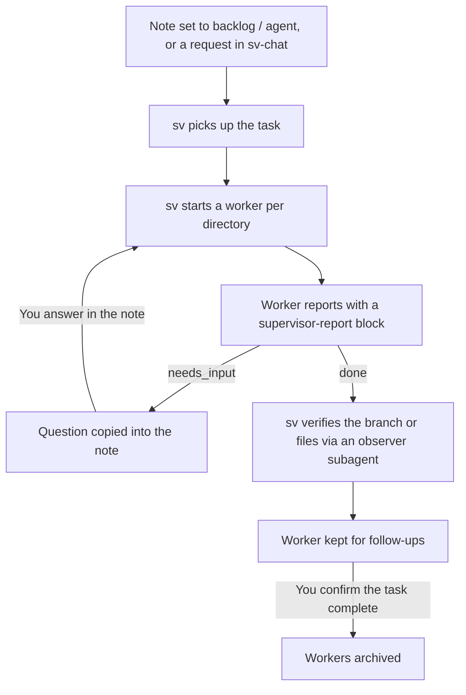

# Session Supervisor Skill

This skill turns one Claude Code session into a **supervisor** that delegates work to other Claude Code sessions (**workers**) and tracks it to completion. The supervisor runs in a [Herdr](https://herdr.dev) terminal named `sv` and starts each worker as an `hc` (herdr-core) child: a git worktree per worker in a git repository, or one worker per non-git directory.

Every task and project is a note in an Obsidian vault. You delegate a task by setting its note to `backlog` / `agent`, answer the agent's questions inside the note, and follow progress on a kanban dashboard note (`Supervisor.md`). The supervisor's runtime data lives in a validated `state.json` that survives context compaction, resume, `/clear`, and re-creation of the supervisor.

The supervisor itself never edits, commits, or pushes. Changes go to workers, observation goes to subagents, and a PreToolUse guard installed by `setup` blocks out-of-directory edits and mutating git / jj / gh commands. A push or pull request happens only when you consent to it, and always by a worker.

---

## 1. Requirements

*   **Claude Code** (`claude`), running inside **Herdr** with `hc` (herdr-core) installed.
*   **Python 3** (standard library only) for `scripts/state_tool.py`.
*   **Obsidian** with the core **Bases** plugin for the kanban dashboard. The **Templater** plugin is optional; it powers the status shortcut and the project picker.

---

## 2. Setup

Run the skill from any Claude Code session outside a git repository and ask it to set up a supervisor:

```text
/session-supervisor 監督セッションとして動いて
```

The session asks for the supervisor directory (default `~/supervisor`), runs `setup`, and then walks you through the vault interview (vault location, dashboard note, note templates, and the properties a done or cancelled note gets). `setup` is idempotent and can be run directly:

```bash
python3 skills/session-supervisor/scripts/state_tool.py setup --dir "$HOME/supervisor"
```

It creates, among others:

| Path | Purpose |
| :--- | :--- |
| `<dir>/state.json` | Runtime state, written only through `state_tool.py commit`. |
| `<dir>/CLAUDE.md` | `## Locations` (`clone_root`, `work_root`, `worktree_root`, `vault`, ...) and `## Herdr` (`max_workers`, `worker_path`). |
| `<dir>/.claude/settings.json` | The SessionStart hook (re-injects a digest after compaction) and the PreToolUse guard. |
| `<dir>/sv.sh` | Starts, restarts, and stops the supervisor's sessions. |
| `<dir>/chat/` | The directory of `sv-chat`, the conversational front end. |
| `<vault>/Supervisor.md` | The kanban dashboard note. |

Before the first worker in a git repository, open that repository once with `claude` and answer the trust dialog. The supervisor never answers it.

---

## 3. Starting and Stopping

From any Herdr terminal other than `sv`:

```bash
~/supervisor/sv.sh start
```

| Subcommand | What it does |
| :--- | :--- |
| `start` | Starts `sv`, `sv-watch`, and `sv-chat`, and gives each live project manager a pane. |
| `restart` | Restarts `sv` and `sv-watch` (for example after updating the skill and re-running `setup`). |
| `stop` | Stops `sv`, `sv-watch`, and `sv-chat`. Workers and managers keep running; the next `sv` takes them over. |
| `chat` | Restarts `sv-chat`. |

The sessions it starts:

*   **`sv`**: the supervisor. It is the single writer of `state.json` and the notes.
*   **`sv-watch`**: scans the vault every 10 seconds and wakes `sv` when a note changes.
*   **`sv-chat`**: where you talk in ordinary conversation. It hands your words verbatim to `sv` and shows its answer. Write long instructions here or in notes, not in `sv`, whose input box is shared with `hc` signals.
*   **`w-NNNN`** (workers) and **`p-NNNN`** (project managers): started by `sv`.

---

## 4. Core Workflow



1. **Delegate**: set a task note (tagged `supervised`) to `status: backlog`, `assignee: agent`, or ask `sv-chat`. The note's `## 概要` is the request.
2. **Dispatch**: `sv` picks the target directory (cloning a repository or creating a work directory when needed) and starts one worker per directory.
3. **Answer**: a worker's questions appear as user actions under `## アクション` of the note. Answer there, or directly in the worker's terminal. Write further requests to the agent as `### @agent` headings.
4. **Verify**: when a worker reports `done`, `sv` checks its commit or result files through an observer subagent and records them under `## 成果物` and `## 完了報告`.
5. **Close**: the worker stays open for follow-ups. Once you confirm the task complete in the note (or cancel it), `sv` archives its workers.

Push and pull request creation happen only when the request or a later message explicitly allows it.

---

## 5. Projects

Tasks can be grouped into a **project**: a context document (a GitHub issue or a Notion page), a project directory under `work_root`, and a read-only **project manager** session (`p-NNNN`). The manager reviews each project worker's verified result (the worker is archived only after its approval), answers workers' questions, and proposes redo work and new tasks. A proposed task starts only after you approve it. The project note shows its own tasks on a kanban split by assignee.

---

## 6. Development

The deterministic parts (validated atomic commits, status derivation, note writing, report parsing) live in `scripts/state_tool.py`. Run its tests with:

```bash
python3 -m unittest skills/session-supervisor/tests/test_state_tool.py
```

See [SKILL.md](SKILL.md) for the full procedure and [references/](references/) for the state schema and the worker, manager, and observer briefs.
